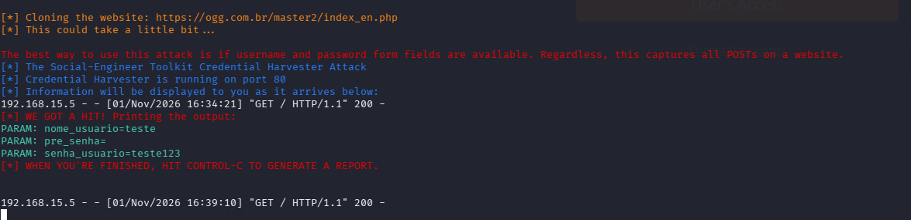

# 🎯 Objetivo do Projeto
Desenvolvido como parte do desafio prático da trilha Formação Cybersecurity Specialist da DIO, este projeto tem como objetivo simular um cenário controlado de engenharia social (phishing por clonagem de página).

A proposta central é demonstrar a vulnerabilidade de formulários não autenticados à interceptação de dados, permitindo compreender a perspectiva do atacante para fundamentar a implementação de mecanismos defensivos e campanhas de conscientização corporativa.

Nota: Todo o conteúdo foi executado estritamente em ambiente de laboratório para fins educacionais.

🛠️ Ambiente do Laboratório
Ambiente: Kali Linux
Ferramenta: setoolkit

### Resutados

Acessando a página clonada atraves do ip do kali

Captura de senha após tentativa de login